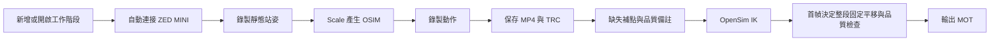

# ZED MINI 動作錄製工作室使用教學

## 電腦需求

- 安裝 ZED SDK **5.5.0**，並確認 ZED Depth Viewer 能顯示相機畫面。
- 使用程式前關閉 ZED Depth Viewer，避免相機同時被兩個程式占用。
- 程式會自動使用已安裝的 NVIDIA 驅動、CUDA 與 ZED SDK，不需要手動提供安裝路徑。
- 請保留 `ZED_MINI_Studio.exe` 旁的 `_internal` 資料夾；不能只複製單一 EXE。



## 1. 使用前準備

- 將 ZED MINI 橫向、水平固定，鏡頭不可在同一工作階段中移動。
- 關閉 ZED Depth Viewer，避免相機被其他程式占用。
- 讓受測者面向相機，確認頭、雙手、雙腳與腳趾都在畫面內。
- 腳下若是白色或反光地面，建議鋪有紋理且不反光的墊子，改善腳部深度追蹤。
- 畫面中只保留一名受測者。

## 2. 啟動程式

從 GitHub 下載 Windows ZIP 後，完整解壓並雙擊 `ZED_MINI_Studio.exe`。從原始碼啟動時，雙擊 `start_studio.bat`。程式會開啟主視窗並自動嘗試連接相機。

第一次使用可按「使用教學」查看內建說明。相機若尚未就緒，等待狀態更新或按「連接相機」重試。

## 3. 建立工作階段

1. 按「新增工作階段」。
2. 輸入容易辨認的英文或數字名稱，例如 `01`、`subject_A`。
3. 同一工作階段只能用於同一位受測者，且相機位置與方向必須保持不變。

若要繼續先前已完成靜態校正的資料，按「開啟既有工作階段」並選擇該資料夾。

## 4. 錄製靜態校正

1. 按「開始靜態校正錄製」，或說「開始靜態錄製」。
2. 走到畫面中央。程式會等待必要骨架點連續完整半秒後才正式開始錄影。
3. 面向鏡頭自然站直，手臂放鬆，保持不動約 3–5 秒。
4. 按「結束錄製並轉換」，或說「結束錄製」。
5. 等待狀態顯示靜態校正完成。

完成後，工作階段外層會產生同名模型，例如 `recordings/01/01.osim`。

## 5. 錄製動作

1. 按「開始動作錄製」，或說「開始錄製」。
2. 等待開始提示音後執行動作。
3. 動作完成後按「結束錄製並轉換」，或說「結束錄製」。
4. 等待 OpenSim 轉換完成。一般不需要再按一次轉換。

每段動作依序建立 `action_01`、`action_02` 等資料夾：

```text
recordings/01/
  01.osim
  action_01/
    action_01.mp4
    action_01.trc
    action_01.mot
    action_01-notes.txt
```

- MP4：原始彩色影片，無骨架、無聲音。
- TRC：經處理的三維標記，已套用與 MOT 相同的固定平移。
- MOT：OpenSim 動作結果。
- notes：補點、裁切、IK 誤差、角度跳變與足底高度。

## 6. 回放與 OpenSim

程式仍開啟時，可在下方清單選取動作並按「回放選取錄製」，使用播放、暫停、時間軸及「顯示骨架」。

在 OpenSim 中：

1. 先載入工作階段的 OSIM，例如 `01.osim`。
2. 再載入同一工作階段動作資料夾中的 MOT，例如 `action_01.mot`。
3. 若同一工作階段曾重新校正，請使用該段轉換時的 OSIM。封存後可在 `diagnostics` 找到該次轉換使用的 `model.osim`。

## 7. 語音口令

- 「開始靜態錄製」：開始等待並錄製靜態校正。
- 「開始錄製」：已有校正時錄製動作；沒有校正時進入靜態錄製。
- 「結束錄製」：結束正式錄影並自動轉換。

口令使用 Windows 內建繁體中文離線辨識。只有完整說出固定口令才會執行，辨識成功與錄影開始／結束都有提示音。

## 8. 常見問題

- **按鈕是灰色**：先新增或開啟工作階段，並確認相機已連接。
- **相機連不上**：關閉 ZED Depth Viewer 或其他占用相機的程式，再重新連接。
- **程式啟動數秒後關閉**：完整解壓 ZIP 後改開 `ZED_MINI_Studio_SafeMode.exe`。若安全模式保持開啟、按「連接相機」後才關閉，通常是 ZED SDK、人體追蹤 AI 或 NVIDIA 驅動相容性問題。請保留程式同層的 `studio_diagnostics.log` 供檢查。
- **一直等待錄製**：確認全身、雙腳及腳趾完整入鏡，畫面中只有一人。
- **腳部掉點**：降低反光、增加地面紋理，讓相機稍微朝下並確保腳趾不出框。
- **轉換有品質警告**：查看 `action_XX-notes.txt`。程式會對有效區段內的缺失做線性補點，備註會列出位置與時間。
- **模型與動作不符**：確認載入的是同一工作階段的 OSIM 與 MOT；移動相機或更換受測者後必須重新做靜態校正。
- **腳沉入 OpenSim 地板**：第一幀足底與地面相距 5 mm，整段沿用第一幀決定的平移量。若後續影格仍低於地面，notes 會列出最低足底高度。手動改左側 XYZ 會被播放的 MOT 數值覆蓋。

## 9. 資料限制

輸出 MOT 保留 IK 求得的關節角度與腰椎活動。標記遮擋或深度不穩時，模型可能在相鄰幀跳到不同姿勢，請依 notes 的時間對照 MP4。IK 誤差衡量模型與三維標記的擬合程度。

每段動作請從雙腳接觸支撐面的姿勢開始，再抬腳或跳躍。固定平移保留各影格之間的垂直位移。交付 TRC 與 MOT 在同一座標系，逐點差距仍受 IK 擬合誤差影響。足底高度檢查涵蓋 MOT 的取樣影格。
